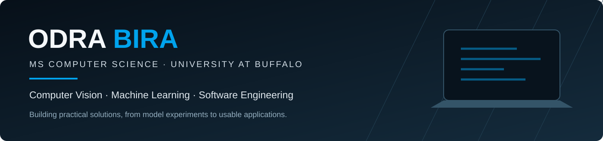

## About Me

I’m a master’s student in Computer Science at the University at Buffalo, interested in computer vision, machine learning, and software engineering. I enjoy building practical solutions—from image restoration and object detection to NLP and full-stack applications.

| Focus Areas | Education | Interests |
| :--- | :--- | :--- |
| Computer Vision · Machine Learning · NLP · Software Engineering | M.S. Computer Science University at Buffalo | Model evaluation · Useful interfaces · End-to-end applications |

## Tech Stack

**Languages**  
    

**Machine Learning & Computer Vision**  
       

**Development & Tools**  
      

## Featured Projects

<table>
<tr>
<td width="50%" valign="top">

### [ShadowFix](https://github.com/odra-bira/ShadowFix)
**Shadow Removal & Image Restoration**

U-Net-based shadow removal using RGB and mask-guided approaches on the ISTD dataset. The project report records **30.19 dB PSNR** and **0.9514 SSIM** for the best model over 540 test images.

PyTorch · U-Net · OpenCV · Gradio

[View code →](https://github.com/odra-bira/ShadowFix)

</td>
<td width="50%" valign="top">

### [Trash Detection](https://github.com/odra-bira/trash_detection)
**Litter Detection & Cleanliness Assessment**

YOLOv8-based litter detection with bounding-box visualization, trash-density heatmaps, and a heuristic cleanliness score. Includes training, inference, and demo code; the original trained checkpoint is not included.

Python · YOLOv8 · OpenCV · Gradio

[View code →](https://github.com/odra-bira/trash_detection)

</td>
</tr>
<tr>
<td width="50%" valign="top">

### [StudyEase](https://github.com/odra-bira/Studyplanner)
**Adaptive Study Planning**

Turns assignment workload and deadlines into manageable study sessions. Combines LLM provider integrations with deterministic schedule validation and repair, an assignment chatbot, stress check-ins, and study breaks.

Python · FastAPI · React · LLM APIs

[View code →](https://github.com/odra-bira/Studyplanner)

</td>
<td width="50%" valign="top">

### [Real-Time Pose Detection](https://github.com/odra-bira/Real-Time-Pose-Detection-and-Exercise-Tracking-main)
**Exercise Tracking**

A webcam-based pose estimation notebook that uses body landmarks and elbow angles to count bicep-curl repetitions.

Python · MediaPipe · OpenCV

[View code →](https://github.com/odra-bira/Real-Time-Pose-Detection-and-Exercise-Tracking-main)

</td>
</tr>
<tr>
<td width="50%" valign="top">

### [Comment Toxicity Classification](https://github.com/odra-bira/comment-toxicity-clean)
**Multi-label NLP Classification**

An experimental bidirectional LSTM classifier for six categories of toxic language, with a Gradio interface.

TensorFlow · BiLSTM · NLP · Gradio

[View code →](https://github.com/odra-bira/comment-toxicity-clean)

</td>
<td width="50%" valign="top">

### [Fruit Quality Classification](https://github.com/odra-bira/agriculture-project)
**Fresh & Rotten Fruit Classification**

A Flask application using a saved MobileNetV2-based Keras model to classify fresh and rotten apples, bananas, and oranges.

TensorFlow/Keras · MobileNetV2 · Flask

[View code →](https://github.com/odra-bira/agriculture-project) · [Publication →](https://doi.org/10.22214/ijraset.2025.68187)

</td>
</tr>
</table>

## What I'm Exploring

Computer vision systems, reliable AI-assisted workflows, and ways to make ML applications easier to use and maintain.

---

<b>Odra Bira</b> · <a href="https://odra-bira.github.io/">Portfolio</a> · <a href="https://www.linkedin.com/in/bira-odra/">LinkedIn</a> · <a href="https://github.com/odra-bira?tab=repositories">All repositories</a>

