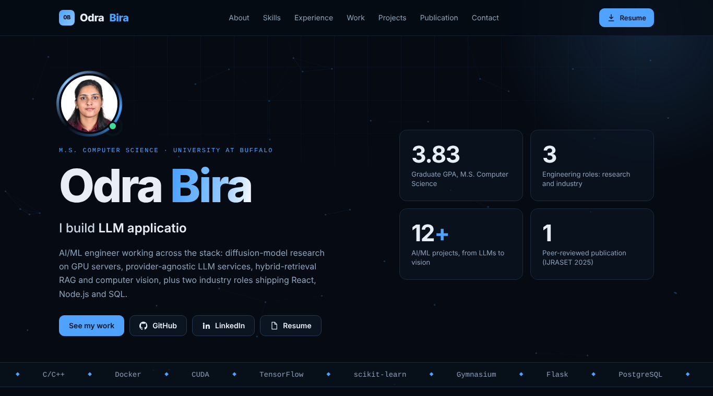

  
  
  
  

### Hi, I'm Odra 👋

AI/ML engineer and **M.S. Computer Science** student at the **University at Buffalo** (AI/ML, 3.83 GPA). I'm a Graduate Student Researcher working on **safe planning with diffusion models**, and I build LLM applications, RAG pipelines and computer vision systems end to end. Before grad school I shipped React, Node.js and SQL features in two industry roles.

🎯 **Open to** AI/ML Engineer, LLM Application and Research Engineer roles from December 2026.

### 🔬 Research

**Graduate Student Researcher, University at Buffalo** (Oct 2025 – Present)
- Benchmark safety-constrained diffusion planners (SafeDiffuser, ICLR 2025) as baselines for lab research
- Trained a temporal U-Net diffusion trajectory planner (1M iterations) with value-guided sampling on D4RL Walker2d, on an RTX 5090
- Closed-form control-barrier-function enforcement met the same safety constraint as QP-based enforcement at **3.2× lower planning latency** (0.64 s → 0.20 s)

### 🚀 Featured projects

| Project | What it does | Highlights | Stack |
|---|---|---|---|
| **[StudyEase](https://github.com/odra-bira/Studyplanner)** | LLM-powered study planner | Provider-agnostic layer over Claude, Gemini and Ollama; validate-and-repair engine for LLM plans; 5 REST endpoints; **35 pytest tests** | FastAPI · React · Pydantic |
| **[ShadowFix](https://github.com/odra-bira/ShadowFix)** | Shadow removal for real photos | Mask-guided U-Net: **30.19 dB PSNR / 0.951 SSIM** on 540 test images, +9.6 dB over the input; Gradio app | PyTorch · OpenCV · Gradio |
| **SkinGPT** | RAG knowledge assistant | Hybrid BM25 + dense retrieval, cross-encoder reranking, cited answers; **1,000-question** eval benchmark, ~75% retrieval precision | Embeddings · Vector search · LLM APIs |
| **[Trash Detection](https://github.com/odra-bira/trash_detection)** | Litter detection and cleanliness scoring | Fine-tuned YOLOv8n (0.78 precision); 0–100 cleanliness score and density heatmaps; CLI + Gradio | YOLOv8 · OpenCV · pytest |

**More:** Receipt-to-JSON LLM fine-tuning (Qwen2.5-3B, QLoRA) · Vision Transformer + GPT from scratch · RL agents with SARSA and n-step Double Q-learning · [Real-Time Pose Tracking](https://github.com/odra-bira/Real-Time-Pose-Detection-and-Exercise-Tracking-main) · [Comment Toxicity Classification](https://github.com/odra-bira/comment-toxicity-clean) · [Fruit Quality Classification](https://github.com/odra-bira/agriculture-project) · Unsupervised learning in R · Elastic Net from scratch

📄 **Publication:** [Automated Assessment of Fruit Quality Using Transfer Learning and MobileNetV2](https://doi.org/10.22214/ijraset.2025.68187), IJRASET 13(4), 2025

### 🧰 Skills

**Languages**

      

**Generative AI & LLMs**

         

**Machine Learning & Computer Vision**

        

**Backend, Data & Tools**

               

<a href="https://odra-bira.github.io/">See everything on my portfolio →</a>

