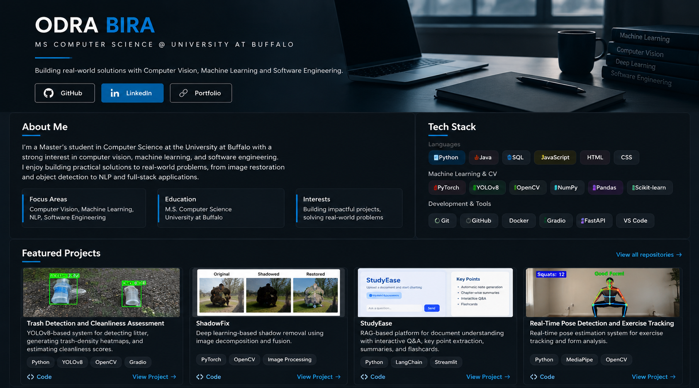

<a href="https://github.com/odra-bira?tab=repositories">GitHub repositories</a> ·
<a href="https://www.linkedin.com/in/bira-odra/">LinkedIn</a> ·
<a href="https://odra-bira.github.io/">Portfolio</a>

<a href="https://github.com/odra-bira/trash_detection">Trash Detection — Code</a> ·
<a href="https://github.com/odra-bira/ShadowFix">ShadowFix — Code</a> ·
<a href="https://github.com/odra-bira/Studyplanner">StudyEase — Code</a> ·
<a href="https://github.com/odra-bira/Real-Time-Pose-Detection-and-Exercise-Tracking-main">Pose Detection — Code</a>

Project details and additional work

The showcase above preserves the supplied design. Current StudyEase implementation: adaptive study planning with React, FastAPI, LLM provider integrations, schedule validation, assignment chat, stress check-ins and study breaks.

The pose tracking repository uses elbow angles to count bicep curls.

Additional projects: [Comment Toxicity Classification](https://github.com/odra-bira/comment-toxicity-clean) · [Fruit Quality Classification](https://github.com/odra-bira/agriculture-project) · [Publication](https://doi.org/10.22214/ijraset.2025.68187).

<!-- Profile author: Odra Bira -->
